# Watch Play Talk

A bilingual (Spanish + English) language-learning app for toddlers and young kids, built in Flutter. Every lesson is three steps led by an on-screen teacher, Maestra Luna:

1. **Watch** a short clip from the weekly episode.
2. **Play** a real action game (Flame engine) that reinforces the lesson.
3. **Talk** a voice quiz checked on the device, with gentle correction and tap answers as a fallback.

Parents get an account, a free trial with monthly or annual plans, child profiles, weekly progress and privacy controls, all behind a parental gate. No ads, no tracking, no child audio leaves the device.

## Demo

| iOS | Android |
|---|---|
| 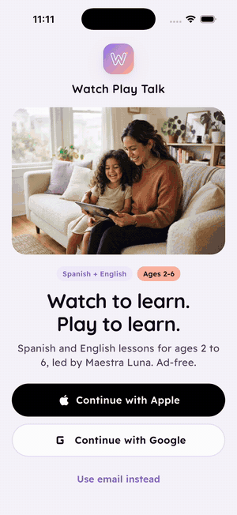 |  |

Same codebase running on both platforms.

## Screenshots

| Welcome | Free trial | Parental gate | Who is learning? |
|---|---|---|---|
| 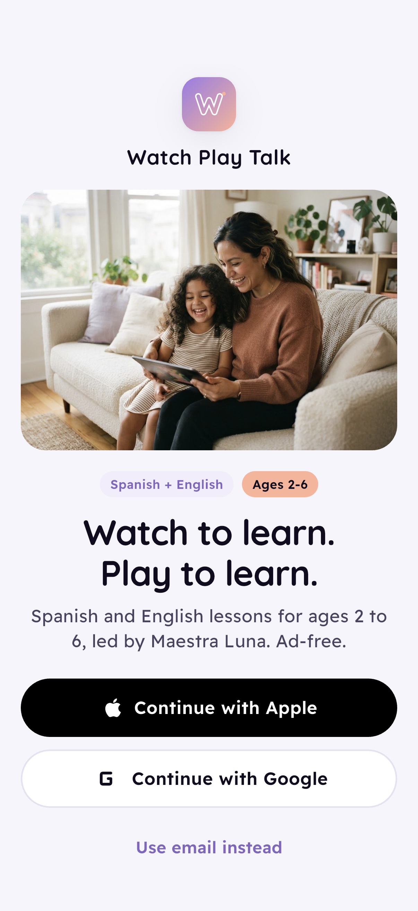 | 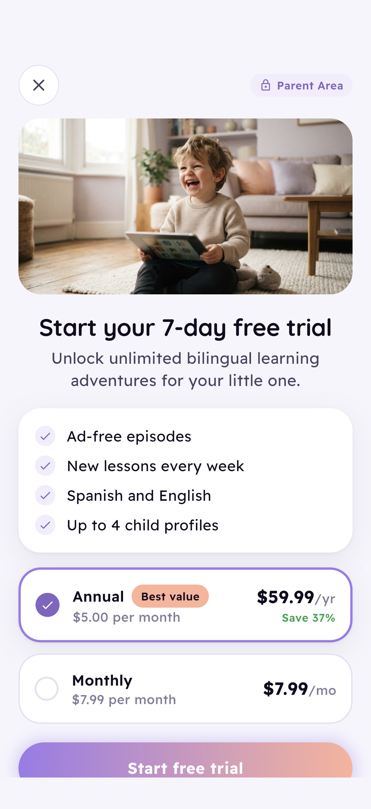 | 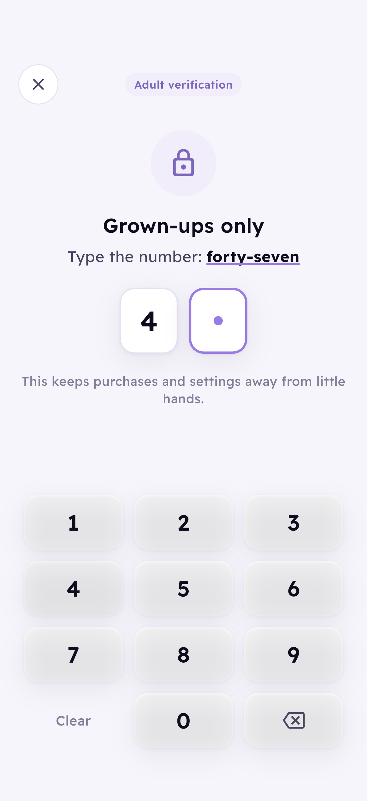 | 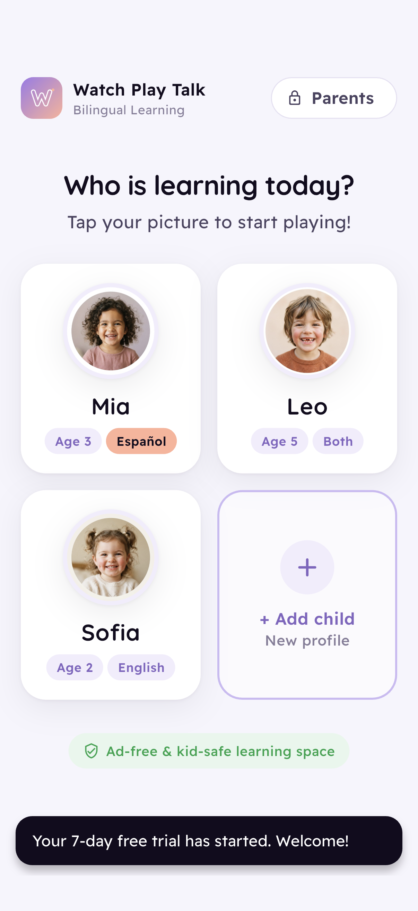 |

| Learn path | Lesson intro | Step 1: Watch | Step 2: Play |
|---|---|---|---|
| 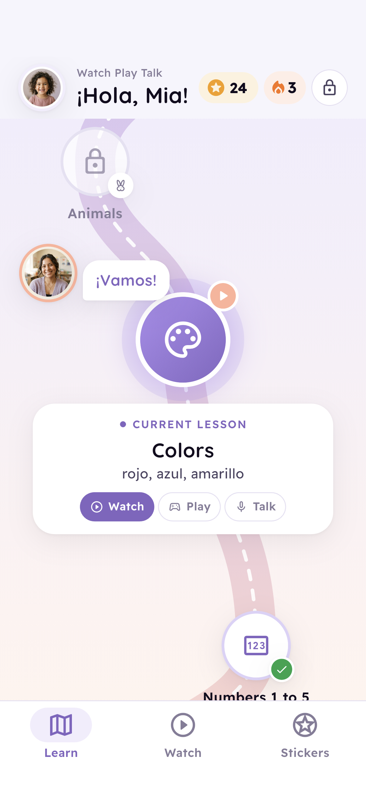 | 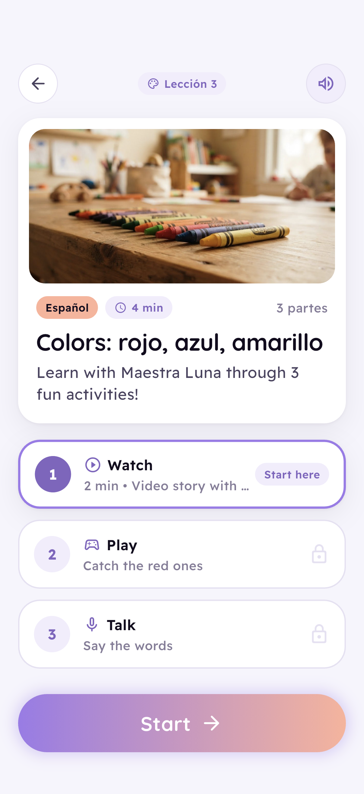 | 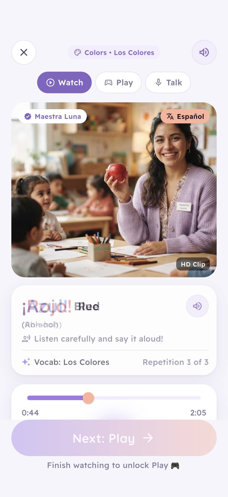 | 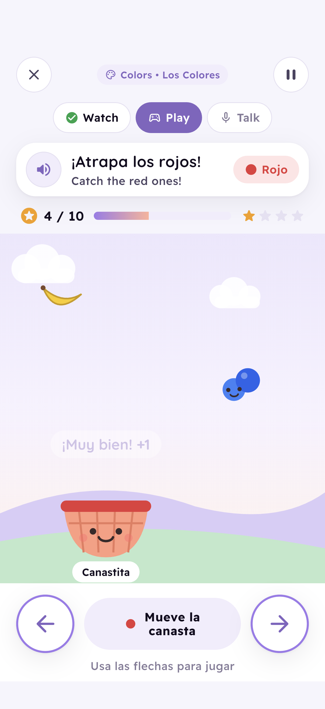 |

| Step 3: Talk | Gentle correction | Lesson complete | First run |
|---|---|---|---|
| 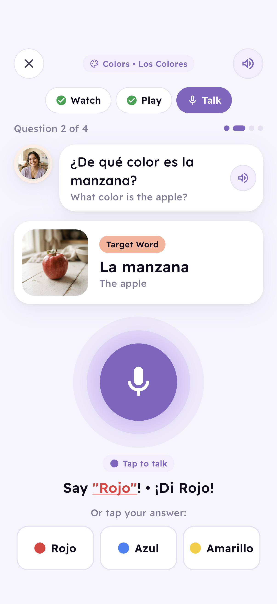 | 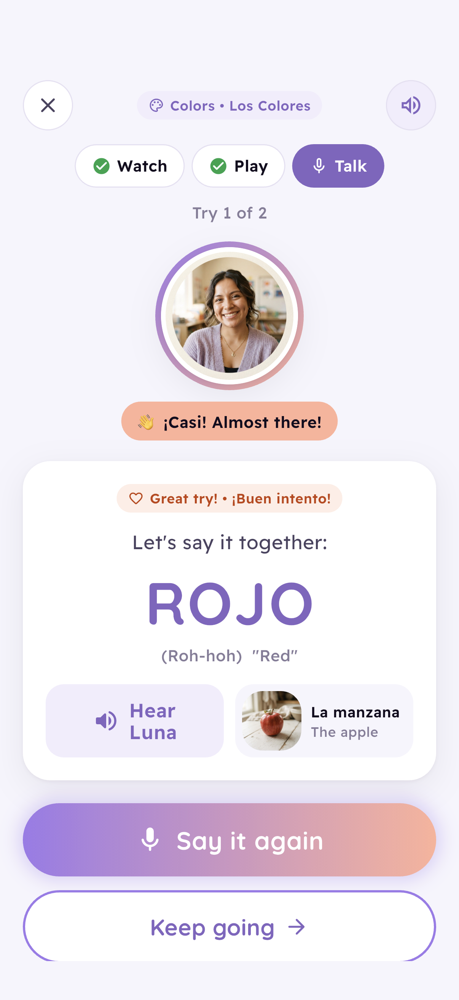 | 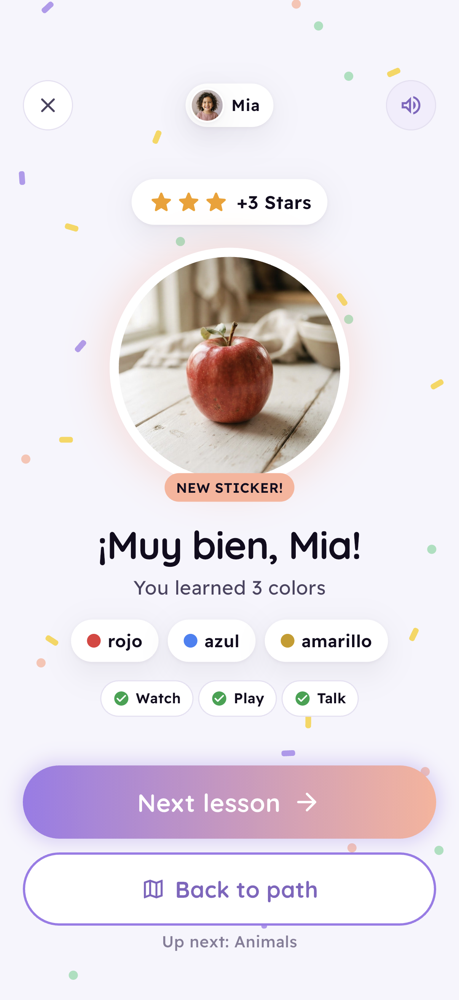 | 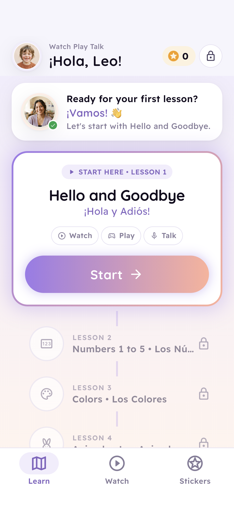 |

| Episodes | Episode player | Sticker book | Parent dashboard |
|---|---|---|---|
| 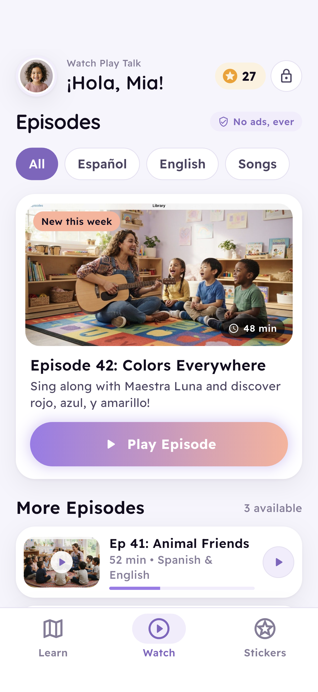 | 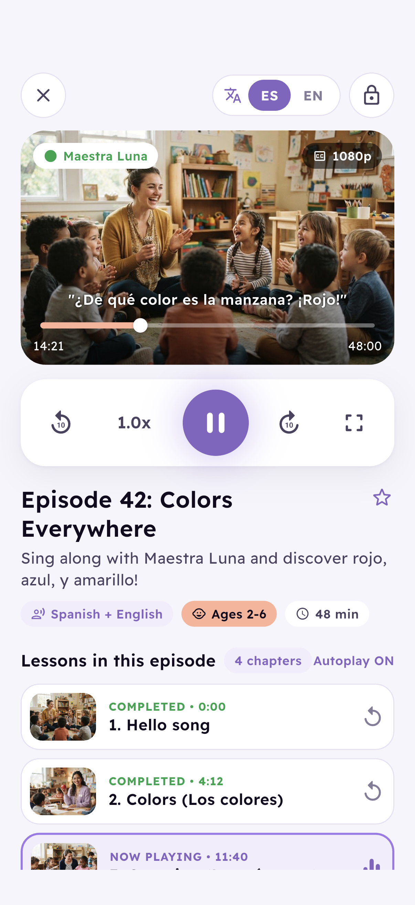 | 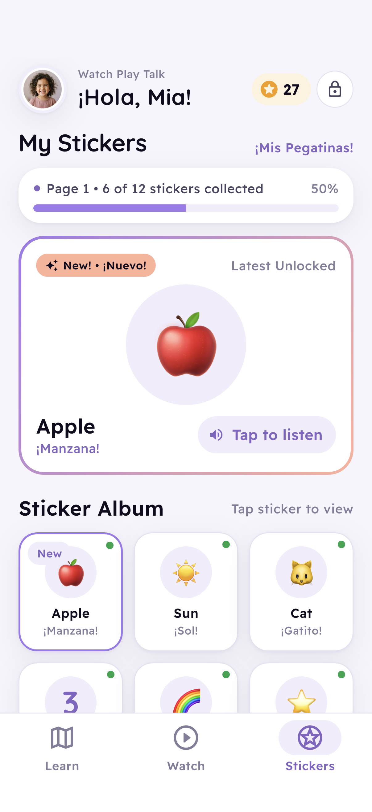 | 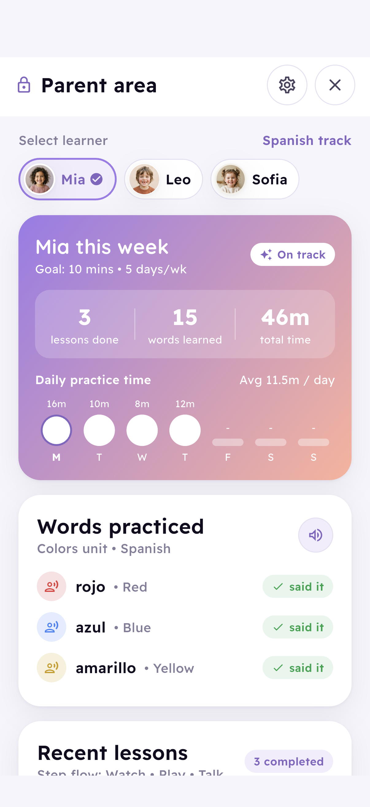 |

| Child progress | Parent settings | Microphone consent |
|---|---|---|
| 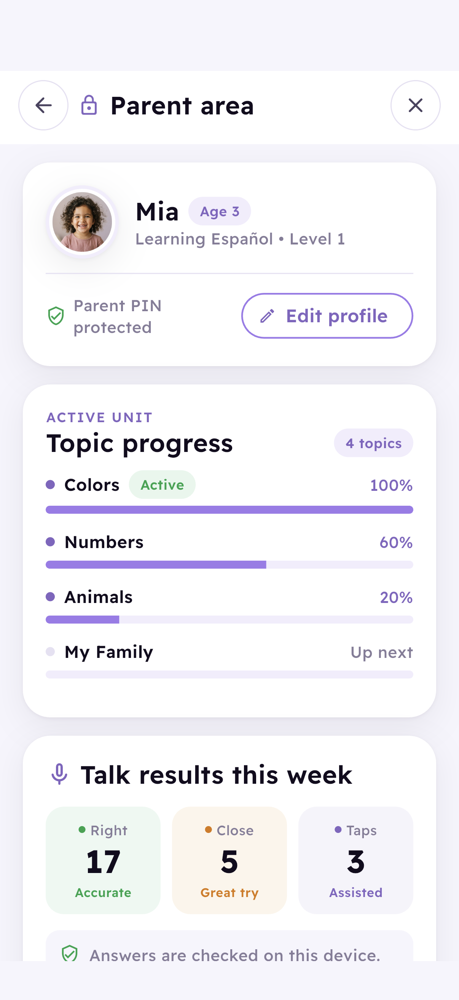 | 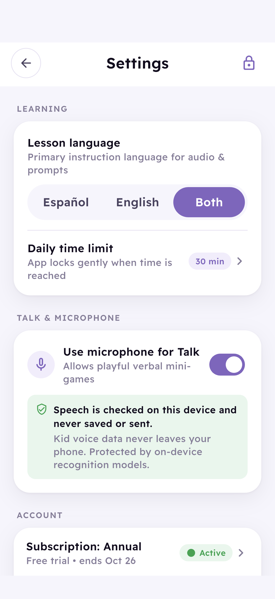 | 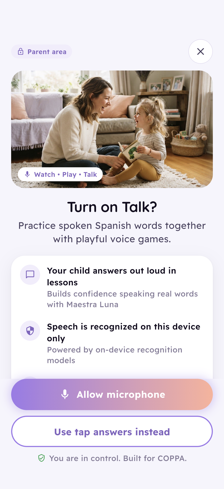 |

**Tablet layout** (side tab rail, two-column learn path):

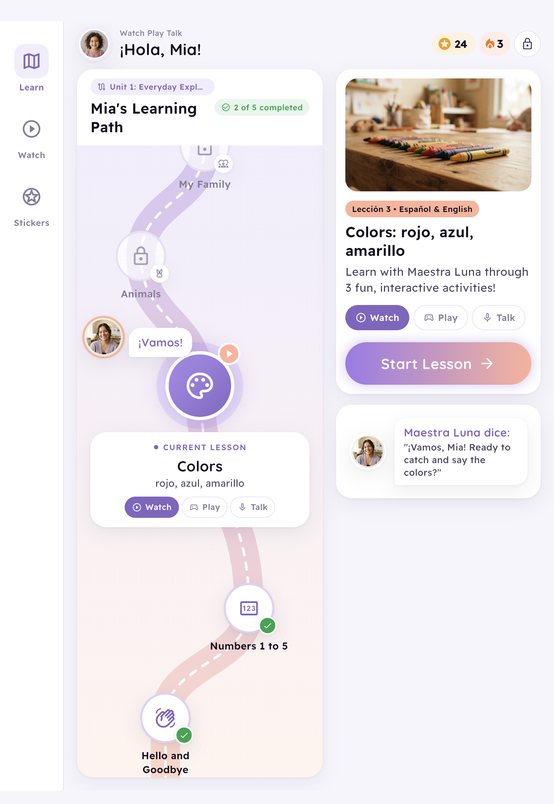

## What it shows

- **Lesson path** - a winding path of lessons (done, current with a glowing node, locked), each with Watch, Play and Talk steps and a sticker reward.
- **Watch** - the lesson clip with timed vocabulary cards (word, translation, pronunciation, repetitions). Play unlocks when the clip ends.
- **Play** - a Flame "Catch" game: steer the basket with arrows or a drag to catch the target items. Real game loop, movement, bounce and floating feedback. No fail state, gentle speed.
- **Game templates fed by approved JSON** - each lesson ships `GameSettings` (template, target, distractors, goal, prompts, speed) parsed through a schema check. Unknown templates, art outside the approved library, or speeds and goals outside toddler limits are rejected before a child sees them.
- **Talk** - a fixed flow: teacher prompt, listen, check, then praise or a gentle "Great try! Let's say it together". Two misses and the teacher models the word and moves on. Tap answers are always available, and are the only input when the parent turns the mic off.
- **On-device answer matcher** - `SpeechCheck` takes the recognizer's N-best text guesses and matches them against a closed answer list in both languages plus toddler forms (`wojo` for rojo), with a bilingual sound-alike key (r/l/w/d, b/v, s/z/c, ll/y, silent h) and a small edit-distance tolerance. Results are right, close or none. It never sees audio.
- **Episodes** - ad-free library with filters and a player with ES/EN captions, chapter list and lesson chapters.
- **Parent area** behind a grown-up gate: learner switcher, weekly goal card with daily practice bubbles, words practiced, recent lessons, child progress with Talk results (right, close, taps), settings (lesson language, daily limit, mic), restore purchases, data export and account deletion.
- **Microphone consent** - plain-language notice before Talk uses the mic, with a tap-only alternative.
- **Phone and tablet** - bottom tab bar on phones, side tab rail and a two-column learn path on tablets.

## Flow

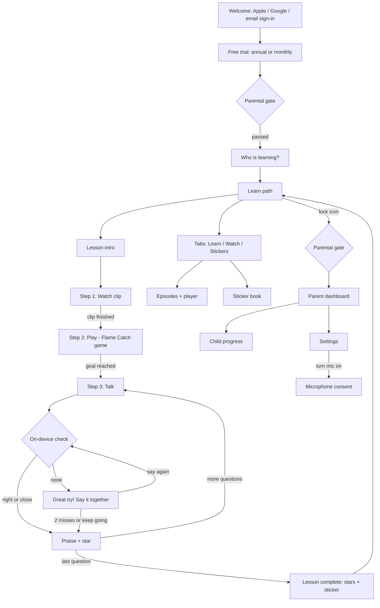

## Architecture

```
lib/
  main.dart, app.dart, router.dart   go_router: onboarding, kid shell (tabs/rail), lesson steps, parent area
  theme/                             design tokens (lavender + peach, Readex Pro + Quicksand) and ThemeData
  models/                            ChildProfile, Lesson, TalkQuestion, Episode, Sticker, ChildProgress
  data/mock_content.dart             lessons, episodes, stickers, children (realistic mock data)
  game/
    game_settings.dart               template settings + schema validation
    catch_game.dart                  Flame game: basket, falling items, floaters, flat 2D art
  services/speech_check.dart         on-device answer matcher (closed list, toddler forms, sound-alike)
  state/providers.dart               Riverpod Notifiers: account, active child, progress, settings
  screens/                           onboarding, learn, lesson, watch, stickers, parent
  widgets/                           shared controls (pills, cards, step pills, kid header, tab bar)
design/                              per-screen HTML design source + DESIGN.md + brief.json
integration_test/                    screenshot and demo walkthroughs
test/                                unit tests for the matcher and game settings validation
```

| Concern | Choice |
|---|---|
| App | Flutter, one codebase for iPhone, iPad, Android phones and tablets |
| State | Riverpod 3 (`Notifier` / `NotifierProvider`) |
| Navigation | go_router with a `StatefulShellRoute` for the kid tabs |
| Games | Flame 2D engine, content from validated `GameSettings` |
| Talk | Fixed state machine + `SpeechCheck`; recognizer simulated behind the mic tap so it runs on a simulator |
| Video | Simulated player with chapters; production plays HLS clip windows by start/end time |
| Billing | Trial and plan selection behind the gate; production uses StoreKit 2 / Play Billing via RevenueCat |
| Privacy | Progress stored as events (right, close, tap), never audio; nickname, age band and avatar only |

Production backend (not in this demo): Supabase (Postgres with row-level security, Storage, Edge Functions) holds approved lessons, entitlements and progress events; the app reads approved lessons only.

## Run

```sh
flutter pub get
flutter run                                   # normal play
flutter run --dart-define=DEMO_AUTOPLAY=true  # Catch game steers itself
flutter test                                  # matcher + game settings tests
```

Requires Dart SDK 3.12+ (built with Flutter 3.44). Fonts are bundled, no network needed.
